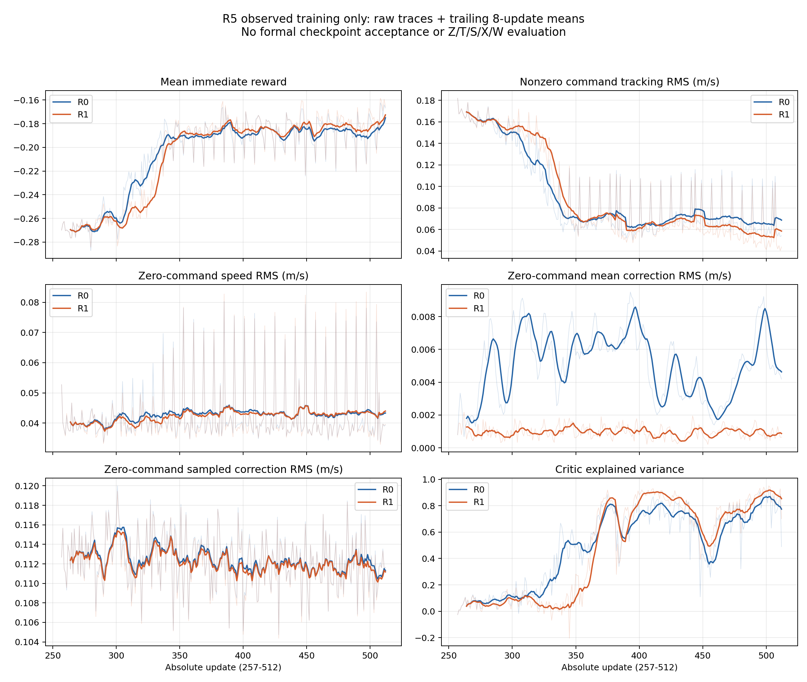

# InstinctRL 最新正式训练结果分析

日期：2026-10-16（Asia/Shanghai）
实验：`R5-FORMAL-MEAN10-FIRST-SEGMENT-01`，绝对更新 257–512
性质：用户要求的离线描述性分析；正式独立 checkpoint 验收仍为 **STOP**。

## 1. 训练效果与结论

**两组都完成了预定训练更新，非零命令跟踪出现明确改善；但尚不能宣布正式 R5 通过，也不能认定 R1 全面优于 R0。**

- 从首32到末32个更新，非零命令跟踪误差 RMS：R0 从 **0.163269 降到 0.068228 m/s**（下降 **58.2%**）；R1 从 **0.163401 降到 0.058656 m/s**（下降 **64.1%**）。直接 reward 同时改善，支持本次训练分布内的学习进展。
- R1 末段跟踪误差比 R0 低 **14.0%**；但全段 RMS 比 R0 高 **3.0%**，全段平均 reward 也略差。因此只能说“R1 末段更好”，不能说“全程更好、收敛更快”。
- R1 的零命令**均值残差**末段比 R0 小 **85.0%**，与均值约束的预期作用一致；但**采样残差**几乎相同，零命令实际速度也未同步改善。均值更接近零不等于悬停更稳。
- 训练没有记录碰撞或高度硬终止，然而零命令条件下的高度偏差仍值得关注。原 Z/T/S/X/W 评价尚未执行，不能据训练日志认定悬停、停车、避障或泛化达标。

本报告读取现存原件与真实 checkpoint，未运行 actor 推理、仿真、训练或 optimizer；没有补造缺失日志、修改原审核、发起评价或恢复批处理。它不占用或冒充流水线尚未执行的最终独立模型分析。

## 2. 实际完成了什么

| 项目 | R0 | R1 |
| --- | --- | --- |
| 精确 job ID | `J-0a6d7c4f861968ed` | `J-838e67f829192ab7` |
| 当前 mean-prior 权重 | 0 | 10 |
| 本段绝对更新 | 257–512，共256 | 257–512，共256 |
| 原始日志观察到的 transitions | 131,072 | 131,072 |
| 新增 actor / critic Adam steps | 2,048 / 2,048 | 2,048 / 2,048 |
| 新 checkpoint | 272、288、320、384、512 | 272、288、320、384、512 |
| 首512样本更新前 gate | PASS | PASS |
| 原生进程状态 | FAILED / -9 | FAILED / -9 |
| 原始结果／collector | PASS_PENDING_CLOSE / INCOMPLETE | PASS_PENDING_CLOSE / INCOMPLETE |
| 所有权清理 | 正常 ACK，两次稳定空扫描，无残留 | 正常 ACK，两次稳定空扫描，无残留 |
| 正式 checkpoint 接受／原五类评价 | 未接受／未执行 | 未接受／未执行 |

两组训练工作量合计262,144 transitions、512个逻辑更新、10个新 checkpoint。这是从原始训练证据观察到的完成量，**不替换 collector 的 INCOMPLETE/null，不解除保守预留**。两组均已 settle，并各使用两次准确绑定的 postrun。

原生 `FAILED/-9` 对应已记录的 `app.close` 9.5秒硬超时；已写出的训练数据与 checkpoint 不因此自动作废，也不能因此将进程状态改为成功。后续独立验收另因证据缺失而 STOP，见第8节。

## 3. 比较对象与统计口径

两组共享同一个 **DEV02 R1 u256、mean-prior=10、pure-hover 训练得到的起点**：

```text
origin checkpoint SHA256:
120a82b54d1debdacd3b2fe38f24ef9fcf25f5e0dfe0ab9741938eaaab327768
frozen formal source:
feb1e96f97e44c7d872cec44268fc2d8b352bc93
config SHA256:
d263cdefa038ecf044e3679ffe470c5f2229e5768bb322e591aa05f0a8710d24
```

本段比较的是**从共同的已受约束起点撤去／保留均值约束**。它不是两组从随机初始化起分别训练“从不约束／始终约束”的比较。两组恢复同一 actor、critic、Adam、RNG，采用共同训练 seed 20260908、fresh reset seed 20261038；保留的首次512输入对象与张量逐项相同。

共同参数为 actor LR `1e-4`、critic LR `3e-4`、零残差 reward 权重 `.05`、anchor 权重 `4`，PPO、控制边界和 reward 定义一致。32个环境每步16个零命令、16个非零命令；命令按128步角色块切换。非零命令覆盖四个轴向 `±0.20 m/s` 和四个对角 `±0.15, ±0.15 m/s`，本段每个方向各8,192个样本。

表格采用三个视图：首32更新257–288、末32更新481–512、全段257–512。每个32更新窗口16,384个样本，零／非零各8,192；全段各65,536。窗口用于事后描述，**不是新增验收门槛**。全段数据一并公开，避免只选择对 R1 有利的末段。

- 跟踪 RMS：`sqrt(mean(||actual_velocity_b - command_b||²))`，只在非零命令样本计算。
- 零命令速度 RMS：`sqrt(mean(||actual_velocity_b||²))`，只在零命令样本计算。
- governor 的三轴修正为 `(2 * action[1:4] - 1) * 0.5 = action[1:4] - 0.5`，单位 m/s。分别对策略均值和真实采样动作计算向量 RMS；不使用错误的 xyz 索引或 `.2` 缩放。
- 直接 reward 是逐步原始 `reward_total` 的平均值，已对各分项求和核对。它与 critic 的 GAE 训练目标不同。

这是一对训练 seed 的相关时间序列。环境、时间步和 minibatch 不视为独立训练重复；本报告不提供虚假的显著性检验或跨 seed 因果结论。策略与物理状态不断变化，窗口差异包含学习过程和轨迹阶段的影响。

## 4. 学习变化：跟踪改善，悬停未同步改善

| 组别／窗口 | 每步直接 reward ↑ | 非零命令跟踪 RMS ↓（m/s） | 零命令实际速度 RMS ↓（m/s） | 零命令均值残差 RMS ↓（m/s） | 零命令采样残差 RMS ↓（m/s） |
| --- | ---: | ---: | ---: | ---: | ---: |
| R0 首32 | -0.267956 | 0.163269 | 0.040154 | 0.004262 | 0.112828 |
| R0 末32 | -0.185170 | 0.068228 | 0.045027 | 0.006152 | 0.112053 |
| R0 全256 | -0.205811 | 0.098940 | 0.043803 | 0.005496 | 0.112429 |
| R1 首32 | -0.267589 | 0.163401 | 0.040021 | 0.001084 | 0.112685 |
| R1 末32 | -0.180630 | 0.058656 | 0.045702 | 0.000921 | 0.111757 |
| R1 全256 | -0.206983 | 0.101873 | 0.043532 | 0.001025 | 0.112211 |


训练曲线如下；浅线为每次更新，深线为后向8更新均值。表格 RMS 是对应窗口内全部样本的合并 RMS，图中的平滑线是每更新 RMS 的算术平均，两者口径略有不同。



[矢量图 SVG](learning_curves.svg) · [完整数值与逐更新数据](observations.json)

非零命令方面，末段实际速度沿目标方向的完成比例 `〈v, c〉 / ||c||²` 的均值，R0为 **0.759**、R1为 **0.835**，较首段约 **0.234／0.232** 明显接近目标；最终控制命令的模长／目标模长均值从约 **0.56** 升到 **0.917／0.983**。这些指标与跟踪误差下降方向一致，但接近单位模长不保证方向或每个样本都正确。

全段八个非零命令方向的误差 RMS 均是 R1 略高于 R0，而末段合并比较为 R1 较低。曲线也显示中前段 R1 有一段适应较慢的过程。因此当前证据支持“本对训练中，继续保留均值约束伴随较小均值偏移和较好的末段跟踪”，不支持“它必然提高样本效率”。

零命令方面，两组实际速度 RMS 从约 **0.040** 升到约 **0.045 m/s**，并未随整体 reward 上升而下降。末段 R1 甚至比 R0 高 **1.5%**。由于这些是混合训练中的零命令区间，包含从非零命令切换后的减速过程，不能直接当作独立静态悬停测试。

### 4.1 为什么均值约束有效，却未明显降低采样扰动

末段 R0／R1 零命令均值残差 RMS 为 **0.006152／0.000921 m/s**，真实采样残差为 **0.112053／0.111757 m/s**。后者仅相差 **0.26%**，幅度仍远大于均值偏移。

当前 auxiliary loss 约束零命令样本的策略均值，形式为 `weight * mean(zero_mask * sum(((mean[1:4] - .5) / .1)²))`，不直接约束 Beta 分布方差。R1全部2,048个 minibatch 的辅助损失均为正，均值约 `0.0005284`；R0全部为0。首更新保存的8个 probe 与原输入、原始排列和辅助公式核对一致，支持约束实际产生了作用这一描述性判断。

现有数据提示采样波动仍是动作幅度的重要组成部分；它**不能单独证明**物理漂移由探索噪声引起，更不能据此归因于 COM 或质量。正式评价使用 `deterministic_mean`，与这里的采样训练轨迹不同，其实际表现必须另测。

### 4.2 reward 改善主要来自哪一部分

| 条件均值 | R0 首32 | R0 末32 | R1 首32 | R1 末32 |
| --- | ---: | ---: | ---: | ---: |
| 零命令直接 reward | -0.191217 | -0.205537 | -0.189791 | -0.204270 |
| 非零命令直接 reward | -0.344696 | -0.164803 | -0.345387 | -0.156989 |

总体 reward 的改善主要来自非零命令；零命令分项没有同步改善。末段非零命令 velocity 代价 R0／R1为 **-0.060587／-0.049749**，R1较好；但 preservation 代价为 **-0.057760／-0.062479**，R1反而更差。平均分改善不能解释为所有约束都改善。

**修正此前状态答复中的解读：**日志 `returns` 从约 `-24.49` 升到 `-18.35／-17.88`，对应 `advantages + values` 的 GAE bootstrap 目标。它受价值估计变化影响，不是独立测试的 episode return，不能单独证明控制效果提高。上面的判断采用直接 reward 和物理跟踪指标。

## 5. 安全覆盖与仍需关注的行为

两组均记录 **128次 timeout reset、0次碰撞、0次高度上／下限终止**。全段最小 exact clearance：R0 **2.169 m**，R1 **2.403 m**；危险条件 `q=1` 样本数均为 **0**。这说明在本次中心区域训练里未观察到这些硬失败；由于没有危险工况覆盖，不能推出避障能力或 W 评价已通过。

零命令样本相对目标高度2m的绝对偏差 p95：

| 窗口 | R0（m） | R1（m） |
| --- | ---: | ---: |
| 首32 | 0.226208 | 0.242973 |
| 末32 | 0.519923 | 0.423376 |
| 全段 | 0.381001 | 0.335629 |

R1 的末段高度偏差低于 R0，但两组均比首段大。应将其视为正式评价需要重点核对的现象，不能只因没有越过硬终止高度就认定高度稳定。这里使用真实 root 高度和混合训练窗口，不能替换原 Z 的传感器、T0与规定协议，也不能据此直接宣布原 Z 失败。

补充的零命令分块观察显示一定正面迹象：每组576个零命令块中64个被 reset 中断；余下512个包含16个末尾截断块。对此明确限定的连续块，最大水平位移 p95 为 **0.229／0.207 m**。432个连续“非零→零”区间均有原记录的停车确认，确认时间均值 **1.422／1.409 s**，p95均为 **1.700 s**；确认后最大漂移 p95 **0.205／0.176 m**。R1部分指标较好，但区间长度和截断条件不同于原 S，不能把这些统计称为正式停车通过率。

整段 mixed-command episode 的水平位移包含主动平移，不能直接与零目标漂移阈值 `.30 m` 比较。

## 6. 数值训练是否失稳

CPU读取两组全部10个真实 checkpoint，核对哈希、精确更新计数、源身份、共同起点、学习率和 Adam step；张量均为有限值。每组256条更新和2,048条 minibatch 记录完整有序，所分析数值有限；真实首次512 gate 已通过，首次输入相同。

| 观察量 | R0 | R1 | 含义与限制 |
| --- | ---: | ---: | --- |
| 全段 PPO clip fraction 均值 | 0.083733 | 0.074387 | 未显示持续接近全裁剪；单 minibatch 峰值仍较高 |
| 全段 value loss 均值 | 0.080119 | 0.087418 | R1并非所有拟合指标都更好 |
| critic explained variance：u257→u512 | -0.026→0.490 | -0.026→0.701 | 对训练目标的拟合改善；不等于独立策略性能 |
| 首更新第8 minibatch 后 analytic Beta KL 均值 | 0.011087 | 0.011650 | 真实保存 probe；R1在这个指标上没有更低 |

这些证据未显示 NaN、checkpoint 损坏或明显数值崩溃，**不构成训练已收敛的证明**。单次更新的 explained variance、全段 loss 和物理行为应分别解释。连续分布 differential entropy 为负、样本近似 KL 偶有负值，也不能单独用作坍缩或非法分布的判据。

## 7. 原始证据核对与日志质量问题

离线脚本核对每组57个原件及其归档副本的 SHA256；验证全部4,096个 compact step × 32环境、预定命令序列、修正动作解码、reward分项求和，以及原日志的逐更新分组均值。保存的真实首更新 probe 与输入、old logp、优势、目标及 minibatch 排列匹配。

同时发现两组 `episodes.jsonl` 都包含**32条完全相同的末尾截断记录重复写入**：

| 项目（每组） | 数量 |
| --- | ---: |
| 原 episode 日志记录 | 192 |
| 按相同 `(env, episode, reset)` 且内容完全一致去重后 | 160 |
| 完整 episode | 128 × 1,000步 |
| 唯一末尾截断 episode | 32 × 96步 |
| 原始 episode 长度直接累加 | 134,144 |
| 去重后长度／compact与update真实计数 | 131,072 |

重复只影响 episode 日志直接累加，比真实计数多3,072；没有证据表明额外发生了这些训练步。command-block日志长度总和仍为131,072。本报告仅在描述性统计视图内对完全一致的重复记录去重，**原件保持不变**，reset与截断数据未伪装成完整 episode。

源码 `finalize_right_censored()` 对 command block 有重复终结保护，对 episode 缺少同等保护，与观察到的重复相容；本报告不把源码推测冒充已证明的具体调用链。后续应单独修复并回归该日志问题。这个发现也说明不能仅用“文件存在”或表面 episode 行数代替计数核对。

## 8. 为什么正式验收仍被阻塞

[现有独立审核](../reviews/joint-actual-training.json)的 verdict 为 **STOP**，阻塞项为 `FORMAL-ACTUAL-CALLBACK-BINDING-MISSING`：两组原始 attempt 都缺少 `actor_mean_prior_binding.json`。冻结的 `formal_segment.train_segment` 在恢复起点后调用 `configure_trainer`，但没有写该绑定证据；写入逻辑存在于另一个 `backend.cold_start` 入口。既有验收分析器因此在接受 checkpoint 前中止。

本报告能核对真实辅助损失及首更新公式，也能读取实际 checkpoint，但**这些补充观察不自动取代原协议要求的运行时绑定证据，不推翻 Reviewer STOP**。原 `R0-training-analysis.json`、`R1-training-analysis.json` 仍是中止记录。已接受评价 checkpoint 列表为空，原 Z/T/S/X/W 未授权、未提交、没有结果，流水线最终独立模型分析未调用。

唯一批处理状态仍为 `STOPPED / MODEL:checkpoint-review`，停机时间2026-10-15 16:43:10（Asia/Shanghai）。本次报告未更改该状态、预算或任何评价授权。

## 9. 能支持的研究决定

| 问题 | 现有证据支持的回答 |
| --- | --- |
| 本段训练执行完了吗？ | 预定更新及checkpoint已写完并清理；原生退出仍FAILED，正式闭环未完成。 |
| 学到非零命令跟踪了吗？ | 在本次训练分布内有明确改善；独立测试表现待验证。 |
| mean-prior=10有没有作用？ | 零命令均值偏移明显更小，辅助损失与probe一致；对实际悬停的收益尚未充分确立。 |
| R1能确定优于R0吗？ | 末段跟踪较好，全段平均较差，零命令速度未更好；暂不能宣布整体优胜。 |
| 能确认收敛、泛化、避障或全部原指标通过吗？ | 不能；单配对seed、危险样本为空、正式评价缺失。 |
| 应立即扩训或调reward/PPO吗？ | 当前证据不足以支持；先解决验收证据问题并完成原定独立评价。 |

下一步首先处理既有证据契约与正式入口的不一致：保留原 STOP 和所有原件，由独立审核明确现存证据是否足以按原要求验收、哪些运行时事实确实无法补证。不得把事后生成的文件冒充原运行日志，也不得默认放宽标准。如果需要新的采样或重跑，应另行绑定准确候选与授权；本报告不提出免费重试或自动扩额。

在真正 checkpoint 被独立接受并由 Commander 准确发行评价输入之后，执行原五个节点与全部 Z/T/S/X/W，重点核对非零跟踪收益、零命令高度／漂移、非零到零停车，以及 deterministic-mean 行为。然后才能形成正式性能结论。当前没有根据要求增加训练长度或改变算法。

## 10. 证据与复现

- [冻结正式 manifest](../../r5-formal-readiness-auto/formal_r5_launch_manifest.json)：原方法、起点、评价和授权边界。
- [原独立审核](../reviews/joint-actual-training.json)：原件哈希、精确job、清理及STOP依据。
- [本次机器可读观察](observations.json)：各窗口、八方向、reward分解、checkpoint、probe、episode／分块统计、输入与源码SHA256。
- [本次CPU分析脚本](analyze.py)：仅读取现存证据，输出描述性结果；不调用策略、optimizer或仿真。
- [曲线PNG](learning_curves.png) / [曲线SVG](learning_curves.svg)。

分析时仓库 HEAD：`8940fc2dd800ee7d23c69a18cb50ce26e4fd1ad4`。本次 `observations.json` SHA256：

```text
972727f95867cad7d95ebc90f6ca47480968f759fb07ae28cc1940d06980d79e
```

在同一工作区使用已有环境复现，输出指定到新的空目录，避免覆盖本次结果：

```bash
CUDA_VISIBLE_DEVICES='' PYTHONDONTWRITEBYTECODE=1 \
PYTHONPATH=.:tools/rlflow:isaaclab-training \
/home/mint/miniconda3/envs/navrl_blackwell_test/bin/python3.11 \
  docs/experiments/r5-formal-first-segment-20261015/offline-analysis-20261016/analyze.py \
  --output /tmp/r5-formal-offline-reproduction-new
```

复现依赖哈希绑定的本地原始轨迹、checkpoint和冻结快照；它们的外部路径记录在JSON中。提交后的HEAD字段或输出路径可能改变，原始数据指标应保持一致。执行脚本成功表示本报告的核对与统计完成，不表示正式验收通过。
